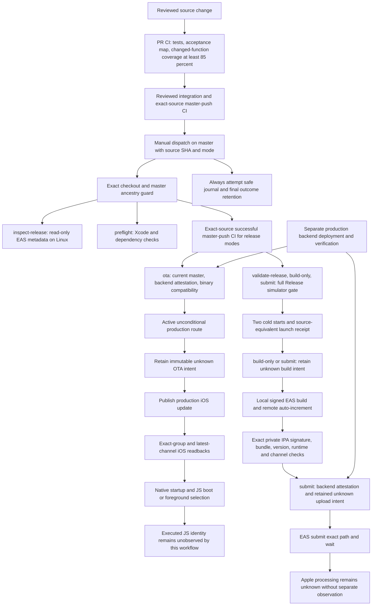

# iOS CD release routes

Dispatch [.github/workflows/cd-ios-testflight.yml](../.github/workflows/cd-ios-testflight.yml)
on `master` with the reviewed 40-character `source_sha`. The workflow verifies
exact checkout and master ancestry before executing selected-checkout helpers.
All six modes are manual. A Git push alone does not publish.

## Full delivery and evidence map



PR CI verifies the proposed patch. Release admission requires a successful
`master` push CI run for the exact selected source and its current attempt.
An ancestor source is permitted for native modes; OTA additionally requires
current master immediately before publication. Stale binary evidence does not
automatically select or dispatch native work.

| Owner | Evidence and limit |
| --- | --- |
| [CD workflow](../.github/workflows/cd-ios-testflight.yml) | Trust, modes, prerequisites, locks, fixed commands and artifact transport. |
| [CI admission](../scripts/check-release-ci.mjs) | Exact source, repository, master-push run and current successful attempt. |
| [Compatibility gate](../scripts/check-ios-ota-compatibility.py) | Conservative source/runtime/channel admission from the checked-in binary record. It does not inspect an installed App. |
| [OTA verifier](../scripts/verify-ios-ota-publication.py) | Published identity, exact-group readback and latest production-channel iOS identity. It does not observe client application. |
| [Inventory reducer](../scripts/inspect-ios-release-inventory.py) | Sanitized independent EAS metadata, including blocked results. EAS candidates do not prove Apple processing or installation. |
| [Simulator gate](../scripts/run-ios-release-launch.py) | Full source-equivalent Release build, two cold starts and sanitized diagnostics. It does not launch the signed device IPA. |
| [Attempt writer](../scripts/write-ios-cd-outcome.py) | Strict local attempt events and immutable pre-write snapshots. It performs no release actions. |
| [App OTA lifecycle](../apps/mobile/src/utils/otaUpdates.ts) | Shared manual and automatic check/fetch/runtime reload, including SDK rollback directives. |

## Production OTA and compatibility policy

The unattended `ota` route requires the reviewed
[binary record](../release/ios-production-binary.json). It names an ancestor
source, runtime, app version, build, production channel, Apple state and evidence.
The current record is build 76, runtime `0.1.11`, from `164ca5c`; it does not
establish an installed `0.1.13` binary. Update it only with evidence actually
checked. A non-object JSON record returns structured `invalid_binary_record`.
No compatibility admission rule is relaxed by this repair.

The already approved local Hither release path treats the latest GitHub source
as the authoritative compatibility comparison baseline. This operator source
attestation is distinct from observed binary provenance. Missing historical
build 79 IPA bytes alone are not a mandatory blocker for that approved path.
Real runtime compatibility, authentication and a publication receipt still need
their own evidence. This unattended workflow retains its conservative record;
it does not manufacture build 79 provenance or a `0.1.13` manifest from the
operator attestation. A historical IPA is unnecessary when other trustworthy
evidence establishes the required binary facts.

The gate compares every mobile change since the recorded binary source with a
conservative JavaScript, TypeScript and test allowlist. Native code, modules,
targets, plugins, patches, app config, package changes, assets and unknown mobile
paths stop OTA. It checks the app and embedded iOS runtime, EAS production build
channel and active unconditional production branch. A missing, stale or
incompatible record stops before publication. Inspect the evidence and choose
an authorized route explicitly.

Set `backend_verified=true` for `ota` or `submit` only after required production
backend changes are deployed and verified. This is an operator attestation;
the workflow neither deploys nor independently attests the backend.
The existing `HITHER_GITHUB_ACTIONS` secret supplies step-local `EXPO_TOKEN`.
The pinned EAS 21.0.2 command loads production environment values before config
evaluation and publishes iOS only. HTTPS legal URLs, current master and the
existing source/runtime/channel guards remain required.

EAS wire contracts differ. `update` and `update:view` format a string branch;
`channel:view` retains GraphQL branch objects inside `Update[][]`. The verifier
checks only the latest nested group and exactly one matching iOS update.
Android may appear first and have another runtime. Wrong iOS ID, group, source,
runtime, message, rollback flag, malformed branch or conditional route rejects.
A matching older group cannot hide a superseding latest group.

SDK 57 can report `isRollBackToEmbedded=true` with `isAvailable=false` or
`isNew=false`. Either directive is actionable through the existing shared
flight. Concurrent automatic and manual callers retain one fetch/reload chain,
existing manual failure statuses and silent embedded-launch notice behavior.
`Updates.reloadAsync` reloads the React Native runtime inside the existing OS
process. It does not explain a missing OS PID.

## Native build and TestFlight

| Mode | Work performed |
| --- | --- |
| `inspect-release` | Linux read-only EAS build/channel/update inventory. |
| `preflight` | Xcode and dependency checks without signing. |
| `validate-release` | Full Release simulator build and two verified cold starts. |
| `ota` | Guarded iOS publication and exact remote readback. |
| `build-only` | Full simulator gate, signed local EAS build and exact IPA verification. |
| `submit` | Same native gates and upload of that exact private IPA path. |

EAS Build history supplies candidates. An IPA built locally on the GitHub Xcode
runner may not appear there. A finished EAS build does not prove Apple
processing, installability, installation, native compatibility or executed JS.
Native modes remain explicitly selectable when the binary record blocks OTA.

The full simulator gate follows [startup validation](ios-release-startup-validation.md).
It requires two 45-second cold starts, verifies real App startup and records
screenshot hashes. The simulator temporarily injects the production update
channel into `Expo.plist`, restores the source file and verifies the compiled
App. Its receipt is source-equivalent Release evidence. The signed device IPA
uses EAS remote auto-increment and is not the simulator artifact.

The simulator inherits EAS production environment values and overlays checked-in
`build.production.env`. Profile values win, matching the pinned signed-build
merge. Supported flat profiles use EAS's default `distribution=store`, store-first
environment inference and explicit environment precedence. Effective preview or
development env rejects. Inheritance and relevant iOS-specific env/inference
overrides reject explicitly rather than silently differing from EAS. Env values
must be strings. No environment dump or secret fingerprint is retained. Server
values can still drift between simulator and signed build.

The workflow verifies the exact private IPA's integrity, signature, app/widget
bundle IDs, source app version, embedded runtime and production channel. Its
receipt records the actual signed build number and IPA SHA-256. Submission uses
only `$RUNNER_TEMP/Hither-production.ipa`, never `--latest` or a candidate URL.
A separate receipt after successful pinned EAS `submit --wait` reports
`easUpload=reported_complete`, `appleProcessing=unknown` and
`deviceAcceptance=not_verified`. No Apple query is added.

For the 2026-10-29 audit/correction round, physical-device and production
behavioral tests are explicitly excluded as completion gates. Their statuses
remain unverified. CI, preflight, a simulator receipt and EAS upload completion
each retain their own scope. None establishes Apple processing, installed-device
or production behavior. Visual screenshot review remains pending.

## Attempt evidence and interrupted writes

The three mutation modes and `validate-release` share `cd-ios-production` with
cancellation disabled. Validation is read-only but is a sensitive production
reader: its cold-launch gate can select a compatible production OTA, and this
workflow does not observe executed JS identity. The common lock prevents this
workflow's OTA publication from interleaving with that validation.
Only `inspect-release` and `preflight` use distinct run-and-attempt diagnostic
keys, so those two cannot replace a pending production-group writer.
`validate-release` still occupies the common group and can replace a pending
member under GitHub's one-pending behavior. This preserves within-workflow read
consistency; it is not a durable FIFO queue and does not lock external
publishers, master changes or server environment changes.

GitHub reruns of `ota`, `build-only` and `submit` reject when `run_attempt` is
greater than one, including pre-mutation failures. Read-only `validate-release`,
`inspect-release` and `preflight` remain rerunnable. After direct outcome
inspection, a fresh dispatch is another operator
intent even at the same source SHA. No source-only deduplication, automatic
retry, rollback or recovery mode is implemented.

Every journal event has exactly six keys. Source is a full lowercase SHA, run ID
is numeric, attempt is a positive integer, and mode, phase and status are finite
allowlists. A trusted workflow-local early-failure serializer may use null source
or mode for invalid dispatch inputs. Those values authorize nothing.

```json
{"sourceSha":"aaaaaaaaaaaaaaaaaaaaaaaaaaaaaaaaaaaaaaaa","runId":"12345","runAttempt":1,"mode":"ota","phase":"ota_publication","status":"unknown"}
```

The writer validates existing journal identity and atomically replaces the
complete JSON Lines file. It serializes no free text, provider output, URLs,
paths, credentials or environment values. Source trust must pass before any
selected-checkout helper executes, including an `always()` finalizer. A source
without the new helper fails before release work and gets the trusted fallback;
tooling is not silently fetched from a different revision. Invalid final journal
data is replaced by a safe unknown event while finalization still fails.

Before OTA publication, signed build/remote auto-increment, or EAS submission,
the workflow writes an immutable six-key unknown intent and uploads its exact
path with the pinned artifact action. Names contain run ID, attempt and phase.
Default success gating and the mutation shell both require successful intent
retention. Failed retention permits zero remote mutations. Final journal/outcome
and successful operation receipts have separate names and never overwrite the
uploaded intent. Retention remains 14 days. Signed IPA, screenshots, raw EAS
responses, provider URLs and raw native logs are excluded from artifacts.

A remote command can be accepted before a local failure, lost response or
invalid output. Its mutation outcome remains unknown. Validated publication
output records publication passed separately from failed readback. Successful
EAS wait records upload passed and Apple processing unknown. A selected mode
or signed-build receipt cannot imply successful upload.

A blocked inventory parser retains its nonzero exit and existing sanitized
receipt. Earlier auth/JSON failures get an attempt failure with no fabricated
inventory. Ordinary failures trigger `always()` outcome retention. Hard runner
loss, forced cancellation, GitHub outage, deletion or expiry can still prevent
later evidence. A retained pre-write intent then supports only an unknown
remote outcome. Artifact delivery is not an exactly-once guarantee.

## Failure history and triage

Record run ID, attempt, pinned source, mode and first failing step. A cleanup
Node deprecation warning does not explain an earlier exit. Compare each gate
with its own retained evidence before another dispatch.

| Historical failed run | First failed gate in retained job logs | Follow-up evidence |
| --- | --- | --- |
| [40431629922](https://github.com/Yupoer/hither_app/actions/runs/40431629922) | The Expo token input was empty before EAS queries. | PR #330 mapped the existing secret; later runs authenticated. |
| [40456813396](https://github.com/Yupoer/hither_app/actions/runs/40456813396), [40459732842](https://github.com/Yupoer/hither_app/actions/runs/40459732842) | Inventory rejected a verified iOS update with a noncanonical platform label. | The first parser change did not fix it. PR #335 passed inventory in [40469578841](https://github.com/Yupoer/hither_app/actions/runs/40469578841). |
| [40471132413](https://github.com/Yupoer/hither_app/actions/runs/40471132413) | Runner CocoaPods version disagreed with `Podfile.lock`. | PR #336 pinned the version; the next run passed this gate. |
| [40474400700](https://github.com/Yupoer/hither_app/actions/runs/40474400700) | Generated privacy categories had the same disclosures in a different order. | PR #337 compares the disclosures while still rejecting changed content; the next run passed this gate. |
| [40479104034](https://github.com/Yupoer/hither_app/actions/runs/40479104034), [40486179433](https://github.com/Yupoer/hither_app/actions/runs/40486179433), [40538498115](https://github.com/Yupoer/hither_app/actions/runs/40538498115) | The full Release simulator did not reach the startup breadcrumb. | The [last run's sanitized diagnostic](https://github.com/Yupoer/hither_app/actions/runs/40538498115/artifacts/12752148731) shows `ProcessLookupError`, no matching crash report, and no runtime log signal. The cause remains unproven. PRs #339 and #340 added diagnostics, not a root-cause fix. |
| [40696292714](https://github.com/Yupoer/hither_app/actions/runs/40696292714) | The full Release simulator did not reach the startup breadcrumb. | The sanitized diagnostic reports `appProcessState=absent`, `processAlive=false`, and `simulatorState=booted`. Bundle-only system log hints include `jetsam` and `watchdog`; the earlier probe could not attribute either signal to the launched App PID. The cause remains unknown. |
| [40816052797](https://github.com/Yupoer/hither_app/actions/runs/40816052797), source `57d91e882a0f8fb3e2798c4fe2e5243624b0a0f1` | Source CI and toolchain passed; cold launch failed on attempt 1 while waiting to observe the startup breadcrumb. | The [sanitized diagnostic](https://github.com/Yupoer/hither_app/actions/runs/40816052797/artifacts/12873064423) reports original host PID alive at launch, App absent, simulator booted, no matching crash report or runtime signal, empty PID-correlated signals, and bundle-only `jetsam`/`process_exit` hints in a seven-second window. `exitCode=1` belongs to the failed gate command, not the App. Cause remains unknown. |
| [40834930383](https://github.com/Yupoer/hither_app/actions/runs/40834930383), source `3fe702a3c55dc726cf661bbba288e62cb6727615` | Runner preflight rejected the launch capture capability check before any App build. | The help reader inspected stdout only. Real child-command fixtures reproduce rejection when identical supported help is on stderr or split between streams. The correction reads both streams for this help call; exact Xcode 27 stream routing still requires native observation. This run supplies no new App crash evidence. |

The last run was dispatched separately from this patch. No rerun or guessed
native fix is part of the contract repair. Future logs contain fixed UTC stage
markers for preflight, simulator setup, Pods, Xcode build, metadata and cold
launch. These reveal stage boundaries; they neither diagnose nor fix App loss.
The env overlay also does not establish a native startup fix.
An absent observed phase does not prove the App never emitted a ready phase.

`ProcessLookupError` alone is not an App crash or PID-probe defect. The sanitized
probe distinguishes original/replacement/absent matching App executables and
simulator state. Bundle-only system hints do not attribute termination to the
App. `pidCorrelatedSystemSignals` requires exact bundle ID and launched PID in a
recognized termination-target form, in the same Apple NDJSON record and inside
the launch interval plus one-second grace. The logging daemon's process ID is
not the App PID. A correlated hint remains an observation rather than a cause.
An unavailable probe failed; an empty list proves only no matching evidence was
found. Advisory diagnostics never turn failed launch into success.

The original launch now redirects stdout/stderr to separate per-attempt files.
Only allowlisted `consoleSignals`, `consoleProbe` and `consoleTruncated` reach
the diagnostic artifact. Parsing reads at most 1 MB per stream. Capture is
runner-local and can continue until App or runner teardown, including after a
successful second launch. Regular log files do not impose a byte limit on App
output. Raw console and unified logs
remain on the runner and are not uploaded. The existing bounded crash-report
wait runs before system-log readback so delayed log flushing can be observed.

A passive Darwin kqueue observer registers the returned launch PID after
checking its installed executable path, then checks that path again. A matching
kernel exit event produces `processExitProbe=observed`; `appExitCode` is present
only for a normal exit with an OS wait status, and `appExitSignal` only for a
signal termination. Kernel exit detail is reported separately as
`appExitDetails`. An exit notification without status leaves `appExitKind`
unknown. `not_observed` means registration succeeded but no exit event was read;
`unavailable` covers unsupported, failed or raced registration. Early exits
before attachment can be missed. Executable-path checks do not establish a
process generation if the same executable replaces a reused PID. These limits
preserve uncertainty. `appExitObservedDuring` distinguishes observation during
the launch check from later failure collection. It records when evidence was
read, not the exact OS exit time; an exit collected after failure does not prove
it preceded or caused that failure. Kernel flags and status follow Apple's public
[event definitions](https://github.com/apple-oss-distributions/xnu/blob/main/bsd/sys/event.h)
and [process filter implementation](https://github.com/apple-oss-distributions/xnu/blob/main/bsd/kern/kern_event.c).

Before the single Release App build, runner preflight checks that `simctl help
launch` exposes stdout/stderr capture in its captured stdout or stderr, and
tests actual host exit code 37 and SIGTERM through the observer. A failed
self-check stops before App build.
Only this help call combines streams. Git, runtime JSON and simulator UUID
commands retain stdout-only results; nonzero help status and either missing
capture flag still reject. Raw help is not printed or uploaded.
The self-check launches the current interpreter's observed executable, including
framework Python installations whose command is a launcher stub.
Child-process success does not prove permission to observe the launchd-owned
simulator App. Its own registration result remains explicit.
Neither self-check nor offline fixtures establish native App acceptance. The
two original 45-second cold launches, fresh breadcrumb/build requirements and
screenshots remain required. No diagnostic relaunch or build retry is added.
The wrapper now calls its failed child return code `commandExitCode`; historical
`exitCode` values still describe the gate command. No unobserved App exit code
or current startup cause is inferred from either field.

The repair's offline checks are separate evidence. Canonical EAS-shaped CLI
fixtures reproduce the nested-list crash and exercise strict latest readback.
SDK-shaped JS behavior tests exercise rollback, races, failures and shared
flight. Real child commands prove profile precedence. Controlled EAS stubs
record acceptance before returning errors to prove unknown-write retention.
These checks do not claim a live publication, signed build or native fix.
The historical `ota-auto-ship.sh` and `task-end-ship.sh` remain retired stubs.

## Remaining proposals

These need their own design and evidence.

- Observe selected JavaScript identity through public Expo identity or a bounded
  read-only SDK database observation while preserving startup and adding no
  required native API.
- Define immutable native/runtime cohorts or reviewed fingerprints and runtime
  rotation. A comparison baseline does not attest a binary's source.
- Attest reviewed public configuration separately from secret server values,
  native capabilities and backend state. Do not hash the complete environment.
- Separate workflow/tooling revision from selected App source explicitly if
  historical source reproduction expands.
- Design exact signed-IPA reuse and verify-only reconciliation around an earlier
  run/attempt and validated remote IDs. Do not republish automatically or infer
  absence from the latest source-matching group.
- Add exact-build Apple processing observation only with separately authorized
  access. Keep processing unknown and device status unverified until observed.
- Define durable queue and external-publisher coordination if required. The
  current concurrency group and attempt journal provide neither.
